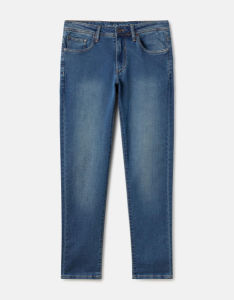
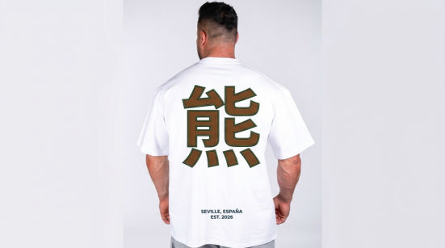
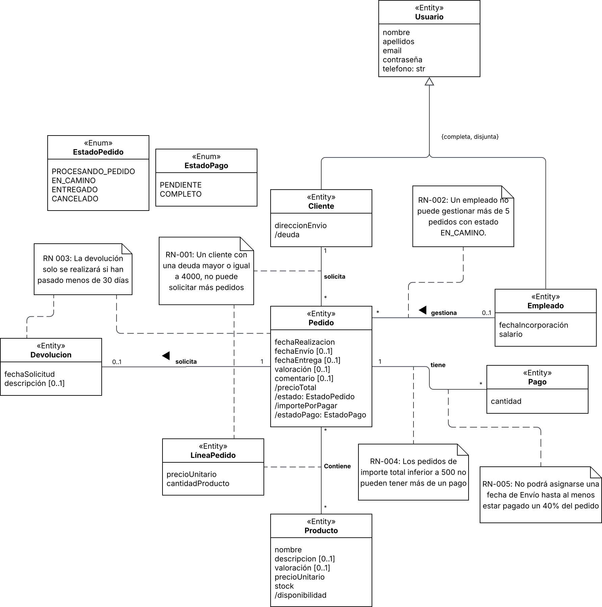

# Tienda de ropa en línea KUMAFU

## Miembros del grupo L1-DF-AM-1 (2026)

1. Moguel Prado, José
2. Lázaro Marín, Rubén
3. Ramírez Fabra, Javier
4. Sicard Muñoz, Carlos

## 1. Introducción al problema

Este proyecto tiene como objetivo diseñar y desarrollar el sistema de información de KUMAFU, una tienda en línea especializada en la venta de ropa, como sudaderas, camisetas y pantalones. El negocio busca digitalizar y automatizar su proceso de venta y mejorar la interacción con los proveedores, encargados de abastecer el inventario, y con los clientes, que utilizarán una interfaz web.

La tienda contará con:

1. Proveedores internos y externos que suministrarán los productos.
2. Una interfaz para realizar pedidos.
3. Opciones para solicitar devoluciones y enviar valoraciones.

### Situación actual y problemas detectados

El principal problema de la gestión actual de la tienda son los cuellos de botella operativos, que dificultan su crecimiento y escalabilidad.

1. **Falta de trazabilidad de las ventas:** No hay un proceso claro para hacer seguimiento de las compras. Los clientes tampoco disponen de un carrito persistente que conserve su estado (activo, abandonado o convertido en pedido).
2. **Gestión manual de pagos y estados:** El procesamiento de los pagos y el seguimiento de los pedidos (desde el pago pendiente hasta la entrega o devolución) carecen de automatización y de trazabilidad financiera.
3. **Gestión ineficiente de las devoluciones:** El proceso no está definido con suficiente claridad, lo que puede generar conflictos con los plazos y disputas sobre los reembolsos.
4. **Falta de valoraciones:** La tienda no dispone de un sistema integrado para conocer la satisfacción de los clientes con los productos adquiridos.

### Expectativas y solución propuesta

Para resolver estas carencias, se desarrollará un sistema integral que cubra el ciclo de vida de la compra. La solución incluirá:

- **Gestión de usuarios y catálogo:** Los usuarios registrados podrán consultar un catálogo de productos con tallas (de XS a XL y talla única) y colores disponibles. El sistema controlará el stock de cada producto.
- **Proceso de compra:** El sistema ofrecerá un carrito temporal que podrá convertirse en un pedido. También registrará los pagos y permitirá utilizar distintos métodos, como Visa, Mastercard, PayPal, Apple Pay y Google Pay.
- **Gestión de devoluciones:** Habrá un módulo para solicitar devoluciones y gestionar reembolsos. Las solicitudes podrán realizarse durante los 30 días posteriores a la compra.
- **Valoraciones y ofertas:** Los usuarios podrán valorar los productos del 1 al 5 y dejar un comentario. Además, el sistema ofrecerá promociones temporales con descuentos aplicados al precio de los productos.

## 2. Glosario de términos

Este glosario recoge los términos del dominio de KUMAFU necesarios para comprender la lógica del negocio y las entidades del modelo:

- **Carrito de compra:** Contenedor temporal que agrupa los productos que un usuario desea adquirir. Puede estar activo, abandonado o convertido en un pedido.
- **Devolución:** Proceso iniciado por el usuario para devolver un pedido y solicitar un reembolso. La solicitud debe realizarse durante los 30 días posteriores a la compra.
- **Ítem de carrito:** Línea del carrito que indica un producto y la cantidad que el usuario desea adquirir. Todo carrito debe contener al menos un ítem.
- **Oferta:** Promoción con fechas de inicio y fin que aplica un descuento superior a cero a determinados productos del catálogo.
- **Pago:** Transacción económica asociada a un pedido. Incluye un identificador de transacción y se realiza mediante alguno de los métodos de pago admitidos.
- **Pedido:** Registro que confirma la intención de compra del usuario. Agrupa los productos seleccionados y calcula el total a partir de sus precios en el momento de la compra.
- **Valoración:** Opinión de un usuario sobre un producto adquirido, compuesta por una puntuación del 1 al 5 y un comentario. Debe aprobarse antes de hacerse pública.
- **Gastos de envío:** Coste adicional que se abonará al realizar un pedido a domicilio.
- **Marketing:** Publicidad o técnicas que utiliza la marca para promocionarse.
- **Talla:** Tamaño o medida de una prenda o accesorio.
- **Producto o prenda:** Artículo de ropa que vende KUMAFU. Tiene una talla de XS a XL o talla única, un color, un precio actual y una cantidad disponible en el almacén, que no puede ser negativa.

- **Baggy:** Tallaje de la prenda más holgada de lo normal.

- **Denim:** Tono del color de un pantalón vaquero.

- **Oversize:** Tallaje de una prenda más larga o grande de lo normal.

- **Cargo:** Tipo de pantalón con varios bolsillos. Tienen más volumen de tamaño.

- **Hoodie:** Término con el cual podemos referir a una sudadera con capucha.

- **Joggers:** Tipo de pantalón largo el cual está ajustado en la zona de los tobillos.

## 3. Visión general del sistema

### 3.1. Requisitos generales

#### OBJ-001: Gestionar las cuentas de usuario
- **Como:** Administrador.
- **Quiero:** Tener la capacidad para gestionar la información de la cuenta de todos los usuarios.
- **Para:** Conocer la informacion del cliente y posibles eliminaciones de usuario.

#### OBJ-002: Gestionar su cuenta un usuario
- **Como:** Cliente.
- **Quiero:** Tener la capacidad para gestionar la información de su propia cuenta.
- **Para:** Su uso en los pedidos a realizar (dirección deseada, horarios de llegada del pedido, etc.).

#### OBJ-003: Control de los pedidos
- **Como:** Encargado de almacén.
- **Quiero:** Saber de que manera se está realizando cada pedido.
- **Para:** mantener una buena trazabilidad entre cada pedido.

#### OBJ-004: Gestionar los productos
- **Como:** Gerente de la tienda.
- **Quiero:** Mantener actualizado el stock las prendas que se encuentran disponibles.
- **Para:** Que el cliente conozca la disponibilidad del producto y el stock restante del mismo.

#### OBJ-005: Gestionar las devoluciones
- **Como:** Gerente de la tienda.
- **Quiero:** Ofrecer un servicio seguro y eficaz de devoluciones.
- **Para:** Que el cliente disponga de facilidades si hay algún problema con el envío o el reparto (producto defectuoso, mensajes de envío realizado fraudulentos, etc.).

#### OBJ-006: Valoración de pedidos
- **Como:** Cliente.
- **Quiero:** Tener la capacidad para valorar la calidad del envío y producto.
- **Para:** Mostrar mi descontento o aprobación con el servicio recibido.

### 3.2. Usuarios del sistema

- Administrador: Gestiona la configuración del sistema y tiene la totalidad de su control.

- Gerente de la tienda: Supervisa el día a día, revisa que prendas son las más vendidas y controla que haya stock suficiente de las prendas.

- Encargado de almacén: Recibe la mercancía nueva y se encarga de revisar su calidad, ingresa las prendas con sus respectivos códigos de barras y talla y prepara los pedidos para su envío.

- Cliente: Podrá realizar pedidos, navegar por la web,proponer una ubicación donde se entregará su pedido si así lo desea y realizar devoluciones si está dentro del plazo delimitado de 30 días.

- Empresa de envío: Tendrá la información del cliente para saber dónde entregar el pedido y a nombre de quién para que no haya problemas de entrega a otras personas, equivocaciones, etc. 

## 4. Catálogo de requisitos

### 4.1. Requisitos funcionales

#### R.F.1.1. Crear cuentas de usuario

- **Como:** administrador.
- **Quiero:** registrar nuevas cuentas de usuario, indicando sus datos y si corresponden a clientes o empleados.
- **Para:** dar acceso al sistema a los usuarios de la tienda.

**Pruebas de aceptación**

- Al introducir los datos obligatorios, se crea la cuenta con el tipo de usuario seleccionado.
- Si faltan datos obligatorios, se informa del problema y no se crea la cuenta.
- La cuenta creada aparece en la consulta de usuarios.

#### R.F.1.2. Consultar cuentas de usuario

- **Como:** administrador.
- **Quiero:** consultar las cuentas de los usuarios y sus datos.
- **Para:** disponer de la información de los clientes y empleados de la tienda.

**Pruebas de aceptación**

- Se muestra el listado de usuarios registrados.
- Al seleccionar un usuario, se muestran sus datos y su tipo de cuenta.
- Si no hay usuarios registrados, se informa de que no hay resultados.

#### R.F.1.3. Modificar cuentas de usuario

- **Como:** administrador.
- **Quiero:** modificar los datos de las cuentas de usuario.
- **Para:** mantener actualizada la información de los clientes y empleados.

**Pruebas de aceptación**

- Al seleccionar una cuenta e introducir datos válidos, se guardan los cambios.
- Si se deja vacío un dato obligatorio, se informa del problema y se conserva la información anterior.
- Al consultar de nuevo la cuenta, se muestran los datos actualizados.

#### R.F.1.4. Eliminar cuentas de usuario

- **Como:** administrador.
- **Quiero:** dar de baja cuentas de usuario.
- **Para:** retirar el acceso a quienes ya no deban utilizar el sistema.

**Pruebas de aceptación**

- Se solicita confirmación antes de dar de baja una cuenta.
- Si se confirma la baja, la cuenta deja de permitir el acceso al sistema.
- Si se cancela la operación, la cuenta permanece activa.
- La baja conserva la información histórica de los pedidos asociados.

#### R.F.2.1. Crear mi cuenta de cliente

- **Como:** cliente.
- **Quiero:** registrarme introduciendo mis datos personales y de acceso.
- **Para:** disponer de una cuenta con la que realizar y consultar mis compras.

**Pruebas de aceptación**

- Al introducir los datos obligatorios, se crea una cuenta de cliente.
- Si faltan datos obligatorios, se informa del problema y no se completa el registro.
- Una vez creada la cuenta, el cliente puede acceder a ella con sus credenciales.

#### R.F.2.2. Consultar mi cuenta de cliente

- **Como:** cliente.
- **Quiero:** consultar mis datos personales, mi dirección de envío y mi deuda acumulada.
- **Para:** comprobar la información disponible en mi perfil para realizar mis pedidos.

**Pruebas de aceptación**

- El cliente puede consultar únicamente los datos de su propia cuenta.
- Se muestran sus datos personales (`nombre`, `apellidos`, `email` y `telefono`), su `direccionEnvio` y su `/deuda` actual.
- Si el cliente no tiene pagos pendientes, se muestra que su deuda acumulada es cero.

#### R.F.2.3. Modificar mi cuenta de cliente

- **Como:** cliente.
- **Quiero:** modificar mis datos personales y mi dirección de envío.
- **Para:** mantener actualizada la información utilizada en mis próximas compras.

**Pruebas de aceptación**

- El cliente puede modificar únicamente los datos de su propia cuenta.
- Al introducir datos válidos, los cambios se guardan y aparecen en las consultas posteriores.
- Si se deja vacío un dato obligatorio, se informa del problema y se conserva la información anterior.
- El cambio de dirección no modifica la dirección de entrega de los pedidos ya confirmados.

#### R.F.2.4. Eliminar mi cuenta de cliente

- **Como:** cliente.
- **Quiero:** dar de baja mi cuenta.
- **Para:** dejar de utilizar mi cuenta en la tienda.

**Pruebas de aceptación**

- El cliente puede solicitar la baja únicamente de su propia cuenta.
- Se solicita confirmación antes de realizar la baja.
- Al confirmar la operación, la cuenta deja de permitir el acceso al sistema.
- Si se cancela la operación, la cuenta permanece activa.
- Se conserva la información histórica de los pedidos asociados.

#### R.F.3.1. Crear pedidos

- **Como:** encargado de almacén.
- **Quiero:** registrar un pedido asociado a un cliente, indicando sus productos y cantidades.
- **Para:** disponer de la información necesaria para preparar su envío.

**Pruebas de aceptación**

- Al introducir datos válidos, se crea un pedido asociado al cliente seleccionado.
- El pedido contiene al menos una línea con un producto y una cantidad entera positiva.
- Si alguna cantidad solicitada supera el stock disponible, se informa del problema y no se registra el pedido.
- Si el cliente tiene una deuda mayor o igual a 500 euros, se rechaza la creación del pedido conforme a R.N.001.
- Si la asignación del pedido a un empleado incumple R.N.002, se rechaza dicha asignación.

#### R.F.3.2. Consultar pedidos

- **Como:** encargado de almacén.
- **Quiero:** consultar los pedidos, sus detalles y el empleado encargado de gestionarlos, con filtros por empleado y estado.
- **Para:** organizar la preparación de los envíos y realizar su seguimiento.

**Pruebas de aceptación**

- Para cada pedido se muestran su identificador, cliente, estado y empleado asignado.
- Al consultar el detalle, se muestran los productos, sus cantidades, el importe total y las fechas de envío y entrega cuando existan.
- La consulta permite conocer los pagos registrados y el importe pendiente del pedido.
- Al filtrar por empleado y estado, se muestran únicamente los pedidos que cumplen ambos criterios.
- Si ningún pedido cumple los filtros, se informa de que no hay resultados.

#### R.F.3.3. Actualizar la gestión de pedidos

- **Como:** encargado de almacén.
- **Quiero:** actualizar el estado, las fechas de envío y entrega y el empleado asignado a un pedido, así como registrar sus pagos.
- **Para:** reflejar el avance de su preparación y entrega.

**Pruebas de aceptación**

- Al modificar un pedido con datos válidos, los cambios quedan registrados.
- Al registrar su envío o su entrega, se guardan las fechas correspondientes (`fechaEnvío` y `fechaEntrega`).
- Si un cambio de empleado incumple R.N.002, se rechaza la reasignación y se conserva el empleado anterior.
- Al consultar nuevamente el pedido, se muestra la información actualizada.
- Al registrar un pago válido, queda asociado al pedido y se actualiza su importe pendiente.
- Si el importe total del pedido es inferior a 500 €, se rechaza registrar un segundo pago, conforme a RN.004.

#### R.F.3.4. Eliminar pedidos

- **Como:** encargado de almacén.
- **Quiero:** eliminar pedidos registrados por error que todavía no se hayan enviado ni tengan pagos asociados.
- **Para:** corregir registros incorrectos antes de iniciar su envío.

**Pruebas de aceptación**

- Se solicita confirmación antes de eliminar un pedido.
- Si el pedido no se ha enviado ni tiene pagos asociados, se elimina junto con sus líneas.
- Si el pedido ya se ha enviado o tiene pagos asociados, se rechaza la eliminación y se informa del motivo.
- Si se cancela la operación, el pedido permanece sin cambios.

#### R.F.4.1. Crear productos

- **Como:** gerente de la tienda.
- **Quiero:** registrar nuevos productos con su nombre, descripción, precio y stock.
- **Para:** incorporar nuevas prendas al catálogo.

**Pruebas de aceptación**

- Al introducir los datos obligatorios y válidos, se registra el producto y se calcula su disponibilidad.
- El precio debe ser mayor que cero y el stock debe ser un número entero mayor o igual que cero.
- Si faltan datos obligatorios o se introducen valores no válidos, se informa del problema y no se crea el producto.
- El producto creado aparece en la consulta del catálogo.

#### R.F.4.2. Consultar productos

- **Como:** gerente de la tienda.
- **Quiero:** consultar los productos y sus existencias, con filtros por nombre, rango de precio y disponibilidad.
- **Para:** conocer el estado del catálogo y detectar los productos agotados.

**Pruebas de aceptación**

- Para cada producto se muestran su nombre, descripción, valoración, precio, stock y disponibilidad.
- Al aplicar varios filtros, se muestran únicamente los productos que cumplen todos los criterios seleccionados.
- Al consultar productos agotados (`/disponibilidad = false`), se muestran únicamente aquellos cuyo stock es cero.
- Si ningún producto cumple los filtros, se informa de que no hay resultados.

#### R.F.4.3. Modificar productos

- **Como:** gerente de la tienda.
- **Quiero:** modificar los datos y el stock de los productos.
- **Para:** mantener actualizado el catálogo y la disponibilidad de las prendas.

**Pruebas de aceptación**

- Al seleccionar un producto e introducir datos válidos, se guardan los cambios.
- Se rechazan los cambios que establezcan un precio menor o igual que cero o un stock negativo.
- Se permite establecer el stock en cero para reflejar que el producto está agotado.
- Al consultar nuevamente el producto, se muestran los datos actualizados.

#### R.F.4.4. Eliminar productos

- **Como:** gerente de la tienda.
- **Quiero:** retirar productos del catálogo.
- **Para:** dejar de ofrecer prendas que ya no se comercializan.

**Pruebas de aceptación**

- Se solicita confirmación antes de retirar un producto.
- Una vez retirado, el producto deja de estar disponible para nuevos pedidos.
- Los pedidos anteriores conservan la información del producto retirado.
- Si se cancela la operación, el producto permanece disponible en las mismas condiciones.

#### R.F.5.1. Crear solicitudes de devolución

- **Como:** gerente de la tienda.
- **Quiero:** registrar una solicitud de devolución asociada al pedido de un cliente.
- **Para:** iniciar la gestión de las incidencias comunicadas por el cliente.

**Pruebas de aceptación**

- Al seleccionar un pedido válido, se registra la solicitud con su fecha, descripción si se proporciona y estado inicial.
- La solicitud queda asociada al pedido seleccionado.
- Se permite registrar la solicitud si han transcurrido menos de 30 días desde la fecha del pedido, conforme a R.N.003.
- Si han transcurrido 30 días o más, se rechaza la solicitud y se informa del motivo.

#### R.F.5.2. Consultar solicitudes de devolución

- **Como:** gerente de la tienda.
- **Quiero:** consultar las solicitudes de devolución y filtrarlas por estado.
- **Para:** conocer las incidencias pendientes y realizar su seguimiento.

**Pruebas de aceptación**

- Para cada solicitud se muestran el pedido asociado, el cliente, la fecha de solicitud y el estado.
- Al seleccionar una solicitud, se muestra su descripción si se ha proporcionado.
- Al filtrar por estado, se muestran únicamente las solicitudes que coinciden con el estado seleccionado.
- Si no existen solicitudes que cumplan los criterios, se informa de que no hay resultados.

#### R.F.5.3. Modificar solicitudes de devolución

- **Como:** gerente de la tienda.
- **Quiero:** actualizar el estado y la descripción de las solicitudes de devolución.
- **Para:** reflejar el avance de su gestión y completar la información de las incidencias.

**Pruebas de aceptación**

- Al seleccionar una solicitud e introducir cambios válidos, se guarda la información actualizada.
- La modificación conserva el pedido asociado y la fecha original de solicitud.
- Al consultar nuevamente la solicitud, se muestran los cambios realizados.
- Si se cancela la modificación, se conserva la información anterior.

#### R.F.5.4. Eliminar solicitudes de devolución

- **Como:** gerente de la tienda.
- **Quiero:** eliminar solicitudes registradas por error cuya tramitación todavía no haya comenzado.
- **Para:** evitar la gestión de solicitudes incorrectas o duplicadas.

**Pruebas de aceptación**

- Se solicita confirmación antes de eliminar una solicitud.
- Si su tramitación no ha comenzado, la solicitud se elimina y deja de aparecer en las consultas.
- Si su tramitación ya ha comenzado, se rechaza la eliminación y se informa del motivo.
- La eliminación de la solicitud no elimina el pedido asociado.

#### R.F.6.1. Crear valoraciones

- **Como:** cliente.
- **Quiero:** registrar una puntuación y un comentario sobre un pedido recibido.
- **Para:** expresar mi satisfacción con los productos y el servicio de entrega.

**Pruebas de aceptación**

- El cliente puede valorar únicamente sus propios pedidos recibidos.
- Se permite registrar una puntuación entera entre 1 y 5 y un comentario.
- Si la puntuación está fuera del rango permitido, se rechaza la valoración y se informa del problema.
- Si el pedido ya tiene una valoración, se indica que debe modificar la existente.

#### R.F.6.2. Consultar valoraciones

- **Como:** cliente.
- **Quiero:** consultar las valoraciones que he realizado sobre mis pedidos.
- **Para:** revisar las opiniones que he registrado sobre mis compras.

**Pruebas de aceptación**

- La consulta muestra únicamente las valoraciones realizadas por el cliente.
- Para cada valoración se muestran el pedido asociado, la puntuación y el comentario.
- Al consultar un pedido sin valoración, se informa de que todavía no se ha valorado.
- Si el cliente no ha realizado ninguna valoración, se informa de ello.

#### R.F.6.3. Modificar valoraciones

- **Como:** cliente.
- **Quiero:** modificar la puntuación y el comentario de mis valoraciones.
- **Para:** corregir o actualizar mi opinión sobre una compra.

**Pruebas de aceptación**

- El cliente puede modificar únicamente sus propias valoraciones.
- Al introducir una puntuación entera entre 1 y 5, se guardan los cambios.
- Si la puntuación no es válida, se rechaza la modificación y se conserva la valoración anterior.
- Al consultar nuevamente la valoración, se muestran la puntuación y el comentario actualizados.

#### R.F.6.4. Eliminar valoraciones

- **Como:** cliente.
- **Quiero:** eliminar las valoraciones que he realizado.
- **Para:** retirar una opinión que ya no deseo mantener registrada.

**Pruebas de aceptación**

- El cliente puede eliminar únicamente sus propias valoraciones.
- Se solicita confirmación antes de eliminar una valoración.
- Al confirmar la eliminación, el pedido deja de tener la puntuación y el comentario asociados.
- La eliminación de la valoración no elimina ni modifica el resto de los datos del pedido.
- Si se cancela la operación, la valoración permanece sin cambios.

#### 4.1.1. Requisitos de información

##### R.I.01. Registro de usuarios, clientes y empleados

- **Como:** Administrador.
- **Quiero:** Registrar los datos de la entidad **Usuario** (`nombre`, `apellidos`, `email`, `password` y `telefono`), diferenciando mediante jerarquía completa y disjunta (`{complete, disjoint}`) entre **Cliente** (`direccionEnvio` y `/deuda` derivada, relacionado con **Pedido** mediante **solicita**) y **Empleado** (`fechaContratación` y `salario`, relacionado con **Pedido** mediante **gestiona**).
- **Para:** Gestionar las cuentas de acceso al sistema, las direcciones de envío y deudas de los clientes, y la asignación de pedidos a los empleados.

**Pruebas de aceptación**

- Comprobar que se almacenan los atributos definidos para **Usuario** (`nombre`, `apellidos`, `email`, `password` y `telefono: str`) y que todo usuario es exclusivamente **Cliente** o **Empleado** (`{complete, disjoint}`).
- Comprobar que para cada **Cliente** se almacena su `direccionEnvio`, se calcula su atributo derivado `/deuda` y se relaciona con los pedidos que solicita (**solicita**, `1` a `0..*`), impidiendo nuevas solicitudes si alcanza o supera los 500 euros de deuda (**R.N.001**).
- Comprobar que para cada **Empleado** se almacenan su `fechaContratación` y `salario`, y se relaciona con los pedidos que gestiona (**gestiona**, `1` a `0..*`), sin superar el límite de 5 pedidos en curso (`{EN_CURSO}`) gestionados simultáneamente (**R.N.002**).

##### R.I.02. Registro de pedidos

- **Como:** Encargado de almacén.
- **Quiero:** Registrar los datos de cada **Pedido** (`fechaEnvío` opcional, `fechaEntrega` opcional, `valoración` opcional, `comentario` opcional y los atributos derivados `/precioTotal`, `/estado: EstadoPedido`, `/importePorPagar` y `/estadoDevolucion: EstadoDevolucion`), así como sus relaciones con el cliente que lo realiza (**solicita** `Cliente`), el empleado que lo gestiona (**gestiona** `Empleado`), los productos incluidos (**Contiene** `Producto` mediante `LineaPedido`), los pagos asociados (**tiene** `Pago`) y su posible devolución (**solicita** `Devolucion`).
- **Para:** Realizar el seguimiento completo de las compras, su estado de tramitación y entrega, sus pagos, sus devoluciones y su valoración.

**Pruebas de aceptación**

- Comprobar que se almacenan los atributos definidos para la entidad **Pedido** (`fechaEnvío` [0..1], `fechaEntrega` [0..1], `valoración` [0..1] y `comentario` [0..1]) y se calculan sus atributos derivados (`/precioTotal`, `/estado: EstadoPedido` [*Procesando*, *Enviado*, *EnReparto*, *Entregado*, *Cancelado*], `/importePorPagar` y `/estadoDevolucion: EstadoDevolucion` [*Enviado*, *EnRevision*, *Aceptada*, *Rechazada*]).
- Comprobar que todo pedido está asociado a un único **Cliente** que lo solicita (`1` a `0..*`), a un único **Empleado** que lo gestiona (`1` a `0..*`) y contiene al menos un **Producto** (`1..*`) a través de **LineaPedido**.
- Comprobar que un pedido puede tener asociados cero o varios pagos (**Pago**, `0..*`) mediante la relación **tiene** y como máximo una **Devolucion** (`0..1`) mediante la relación **solicita**.
- Comprobar que no se permite registrar un nuevo pedido para un cliente cuya `/deuda` sea mayor o igual a 500 euros (**R.N.001**), ni asignarlo a un empleado que ya gestione 5 pedidos en curso (**R.N.002**).

##### R.I.03. Registro de líneas de pedido

- **Como:** Encargado de almacén.
- **Quiero:** Registrar cada **LineaPedido** (`cantidadPedida` y `/precioUnitario` derivado) como clase asociativa de la relación **Contiene** entre **Pedido** y **Producto**.
- **Para:** Conocer el detalle de prendas, cantidades e importes unitarios que componen cada pedido.

**Pruebas de aceptación**

- Comprobar que la clase asociativa **LineaPedido** almacena el atributo `cantidadPedida` y calcula el atributo derivado `/precioUnitario`.
- Comprobar que cada **LineaPedido** vincula un **Pedido** (`0..*`) con al menos un **Producto** (`1..*`) mediante la asociación **Contiene**.

##### R.I.04. Registro de pagos

- **Como:** Cliente.
- **Quiero:** Que el sistema registre los datos de cada **Pago** (`cantidad` y `/estadoPago: EstadoPago` derivado), asociándolo con el pedido correspondiente mediante la relación **tiene** (`Pedido`).
- **Para:** Llevar el control de los importes abonados, el estado de cada cobro y el importe pendiente de pago de cada pedido.

**Pruebas de aceptación**

- Comprobar que se almacena el atributo `cantidad` y se obtiene el atributo derivado `/estadoPago: EstadoPago` (*EnProceso*, *Confirmado* o *Fallido*) definidos para la entidad **Pago**.
- Comprobar que cada pago está asociado obligatoriamente a un único **Pedido** mediante la relación **tiene** (`1` `Pedido` a `0..*` `Pago`).
- Comprobar que si el `/precioTotal` del pedido es inferior a 500 euros no se permite registrar más de un pago para dicho pedido, conforme a la regla de negocio **R.N.004**.

##### R.I.05. Registro de productos

- **Como:** Gerente de la tienda.
- **Quiero:** Registrar los datos de cada **Producto** (`nombre`, `descripcion` opcional, `valoración` opcional, `precio`, `stock` y `/disponibilidad` derivada) junto con su relación con los pedidos en los que se incluye (**Contiene** `Pedido` a través de `LineaPedido`).
- **Para:** Disponer del catálogo de prendas actualizado con sus características, existencias, disponibilidad y precios para su consulta y venta.

**Pruebas de aceptación**

- Comprobar que se almacenan los atributos definidos para la entidad **Producto** (`nombre`, `descripcion` [0..1], `valoración` [0..1], `precio` y `stock`) y que `/disponibilidad` se calcula como atributo derivado en función de las existencias.
- Comprobar que un producto puede formar parte de cero o varios pedidos (`0..*`) a través de la asociación **Contiene** y la clase asociativa **LineaPedido**.

##### R.I.06. Registro de devoluciones

- **Como:** Gerente de la tienda.
- **Quiero:** Registrar las solicitudes de **Devolucion** (`fechaSolicitud` y `descripción` opcional), asociándolas con su pedido correspondiente mediante la relación **solicita** (`Pedido`).
- **Para:** Gestionar las incidencias comunicadas sobre los pedidos y reflejar su evolución en el `/estadoDevolucion` del pedido.

**Pruebas de aceptación**

- Comprobar que se almacenan los atributos definidos para la entidad **Devolucion** (`fechaSolicitud` y `descripción` [0..1]).
- Comprobar que cada **Devolucion** se asocia obligatoriamente a un único **Pedido** mediante la relación **solicita** (`1` `Pedido` a `0..1` `Devolucion`), reflejando el estado de tramitación en el atributo derivado `/estadoDevolucion: EstadoDevolucion` del pedido (*Enviado*, *EnRevision*, *Aceptada* o *Rechazada*).
- Comprobar que solo se permite registrar una devolución si han transcurrido menos de 30 días, conforme a la regla de negocio **R.N.003**.

#### 4.1.2. Reglas de negocio

##### R.N.001. Evitar compras de alta deuda con clientes

Como jefe de Kumafu,
quiero que la deuda de los clientes nunca sea superior a 4000 euros, para evitar perdidas financieras elevadas en caso de que un cliente tarde en pagar sus deudas.

##### R.N.002. Limitación de gestiones de pedido

Como jefe de recursos humanos,
quiero que los empleados no puedan gestionar más de 5 pedidos en curso, para evitar sobrecarga de trabajo y garantizar la gestión de cada pedido de la forma más centrada posible.

##### R.N.003. Tiempo de devolución

Como director de marketing,
quiero que solo se pueda devolver un producto si han pasado menos de 30 días, para no dar un márgen de prueba de los productos Kumafu demasiado alto.

##### R.N.004. Limitaciones de pagos múltiples

Como jefe de Kumafu,
quiero prohibir que los pedidos de importe total inferior a 500 euros se hagan con más de un pago, para reducir el número de deudas a la venta al pormenor.

##### R.N.005. Pago inicial en pedidos

Como jefe de Kumafu,
quiero que no se pueda empezar a enviar un pedido hasta que se haya pagado un 40% del valor de este, para afianzar la compra con el cliente.

### 4.2. Mapa de historias de usuario (opcional)

### 4.3. Requisitos no funcionales (opcional)

#### R.N.F.01. Tiempo de respuesta en consultas del catálogo

- **Como:** Cliente.
- **Quiero:** Que las consultas y el filtrado de productos por nombre, precio o disponibilidad respondan en menos de 2 segundos.
- **Para:** Navegar por el catálogo de forma fluida sin tiempos de espera que dificulten la compra.

#### R.N.F.02. Protección de credenciales y datos de acceso

- **Como:** Administrador.
- **Quiero:** Que las contraseñas de los usuarios (`password`) se almacenen de forma cifrada y que nunca se expongan en texto plano en las consultas del sistema.
- **Para:** Garantizar la privacidad y la seguridad de las cuentas de los clientes y empleados.

#### R.N.F.03. Integridad transaccional en pedidos y pagos

- **Como:** Gerente de la tienda.
- **Quiero:** Que el registro de pedidos, sus líneas de detalle, los pagos y las actualizaciones de stock se ejecuten de forma atómica (propiedades ACID).
- **Para:** Evitar inconsistencias en el inventario o en el cálculo de la deuda del cliente ante posibles fallos del sistema durante una compra.

#### R.N.F.04. Compatibilidad con el gestor de base de datos

- **Como:** Administrador.
- **Quiero:** Que la persistencia de datos, restricciones declarativas, procedimientos y disparadores funcionen íntegramente sobre un servidor de bases de datos MariaDB.
- **Para:** Asegurar la portabilidad, el despliegue estandarizado y el cumplimiento de la normativa técnica del sistema.

#### R.N.F.05. Usabilidad y diseño adaptable de la interfaz web

- **Como:** Cliente.
- **Quiero:** Que la interfaz web de la tienda sea intuitiva y se adapte correctamente tanto a ordenadores como a dispositivos móviles.
- **Para:** Poder consultar el catálogo, realizar pedidos y gestionar devoluciones cómodamente desde cualquier dispositivo.

---

## 5. Modelo conceptual

### 5.1. Diagramas de clases UML

### 5.2. Escenarios de prueba

A continuación se presentan tres escenarios de prueba que validan el comportamiento del modelo conceptual mediante descripciones textuales.

---

#### Escenarios de prueba de la RN-001

**Casos positivos**

- Un cliente sin deudas con la empresa introduce en la linea de pedido 100 camisetas a 20 euros cada una.
- Un cliente sin deudas con la empresa introduce en la linea de pedido 100 chaquetas a 40 euros cada una.
- Un cliente con una deuda calculada de 2000 euros hacia la empresa introduce una linea de pedido con un valor total de 1999'99 euros.

**Casos negativos**

- Salta error cuando un cliente sin deudas intenta introducir una linea de pedido de 100 chaquetas a 40 euros cada una.
- Salta error cuando un cliente con una deuda de 3980 euros intenta introducir una linea de pedido de 1 pantalón a 30 euros.

#### Escenarios de prueba de la RN-002

**Casos positivos**

- Un empleado de la empresa está a cargo de 3 pedidos y llega una petición para realizar otro pedido más.
- Un empleado de la empresa no tiene ningún pedido asociado y le llegan 4 peticiones al mismo tiempo para encargarse de 4 pedidos.
- Salta un error cuando un empleado de la empresa con 5 pedidos asignados recibe una petición para encargarse de otro pedido más.

**Casos negativos**

- Salta error cuando un empleado está a cargo de 1 pedido y llega una petición para realizar otro pedido más.
- No salta ningún error si un empleado de la empresa con 5 pedidos asignados recibe una petición para encargarse de otro pedido más.

#### Escenarios de prueba de la RN-003

**Casos positivos**

- Un cliente trata de hacer una devolución a la semana de comprar el producto.
- Salta un error cuando un cliente trata de hacer una devolución a los dos meses de comprar el producto.
- Un cliente trata de hacer una devolución a los 29 días de comprar el producto a las 23:59:50 de la noche.

**Casos negativos**

- Salta error cuando un cliente trata de hacer una devolución al día siguiente de comprar el producto.

---

## 6. Matrices de trazabilidad

Matriz de trazabilidad entre los objetivos generales y los requisitos de información y reglas de negocio:

|            | OBJ-001 | OBJ-002 | OBJ-003 | OBJ-004 | OBJ-005 | OBJ-006 |
| :--------- | :-----: | :-----: | :-----: | :-----: | :-----: | :-----: |
| **RI-01**  |    X    |    X    |    X    |         |         |         |
| **RI-02**  |         |    X    |    X    |         |    X    |    X    |
| **RI-03**  |         |         |    X    |    X    |         |         |
| **RI-04**  |         |    X    |    X    |         |         |         |
| **RI-05**  |         |         |         |    X    |         |    X    |
| **RI-06**  |         |    X    |    X    |         |    X    |         |
| **RN-001** |         |         |    X    |         |         |         |
| **RN-002** |         |         |    X    |         |         |         |
| **RN-003** |         |         |         |         |    X    |         |
| **RN-004** |         |         |    X    |         |         |         |

Matriz de trazabilidad entre los requisitos funcionales y los requisitos de información y reglas de negocio:

|            | RI-01 | RI-02 | RI-03 | RI-04 | RI-05 | RI-06 | RN-001 | RN-002 | RN-003 | RN-004 |
| :--------- | :---: | :---: | :---: | :---: | :---: | :---: | :----: | :----: | :----: | :----: |
| **RF-1.1** |   X   |       |       |       |       |       |        |        |        |        |
| **RF-1.2** |   X   |       |       |       |       |       |        |        |        |        |
| **RF-1.3** |   X   |       |       |       |       |       |        |        |        |        |
| **RF-1.4** |   X   |   X   |       |       |       |       |        |        |        |        |
| **RF-2.1** |   X   |       |       |       |       |       |        |        |        |        |
| **RF-2.2** |   X   |       |       |   X   |       |       |        |        |        |        |
| **RF-2.3** |   X   |       |       |       |       |       |        |        |        |        |
| **RF-2.4** |   X   |   X   |       |       |       |       |        |        |        |        |
| **RF-3.1** |   X   |   X   |   X   |       |   X   |       |   X    |   X    |        |        |
| **RF-3.2** |   X   |   X   |   X   |   X   |   X   |       |        |        |        |        |
| **RF-3.3** |   X   |   X   |       |   X   |       |       |        |   X    |        |   X    |
| **RF-3.4** |       |   X   |   X   |   X   |       |       |        |        |        |        |
| **RF-4.1** |       |       |       |       |   X   |       |        |        |        |        |
| **RF-4.2** |       |       |       |       |   X   |       |        |        |        |        |
| **RF-4.3** |       |       |       |       |   X   |       |        |        |        |        |
| **RF-4.4** |       |       |   X   |       |   X   |       |        |        |        |        |
| **RF-5.1** |   X   |   X   |       |       |       |   X   |        |        |   X    |        |
| **RF-5.2** |   X   |   X   |       |       |       |   X   |        |        |        |        |
| **RF-5.3** |       |   X   |       |       |       |   X   |        |        |        |        |
| **RF-5.4** |       |   X   |       |       |       |   X   |        |        |        |        |
| **RF-6.1** |   X   |   X   |       |       |       |       |        |        |        |        |
| **RF-6.2** |   X   |   X   |       |       |       |       |        |        |        |        |
| **RF-6.3** |   X   |   X   |       |       |       |       |        |        |        |        |
| **RF-6.4** |   X   |   X   |       |       |       |       |        |        |        |        |

Matriz de trazabilidad entre los elementos del modelo conceptual y los requisitos de información y reglas de negocio:

|            | Usuario | Cliente | Empleado | Pedido | LineaPedido | Producto | Pago  | Devolucion | Asoc. solicita (Pedido) | Asoc. gestiona | Asoc. Contiene | Asoc. tiene (Pago) | Asoc. solicita (Devolucion) | Restr. RN-001 | Restr. RN-002 | Restr. RN-003 | Restr. RN-004 |
| :--------- | :-----: | :-----: | :------: | :----: | :---------: | :------: | :---: | :--------: | :---------------------: | :------------: | :------------: | :----------------: | :-------------------------: | :-----------: | :-----------: | :-----------: | :-----------: |
| **RI-01**  |    X    |    X    |    X     |   X    |             |          |       |            |            X            |       X        |                |                    |                             |       X       |       X       |               |               |
| **RI-02**  |         |    X    |    X     |   X    |      X      |          |   X   |     X      |            X            |       X        |       X        |         X          |              X              |       X       |       X       |       X       |       X       |
| **RI-03**  |         |         |          |   X    |      X      |    X     |       |            |                         |                |       X        |                    |                             |               |               |               |               |
| **RI-04**  |         |         |          |   X    |             |          |   X   |            |                         |                |                |         X          |                             |               |               |               |       X       |
| **RI-05**  |         |         |          |        |      X      |    X     |       |            |                         |                |       X        |                    |                             |               |               |               |               |
| **RI-06**  |         |         |          |   X    |             |          |       |     X      |                         |                |                |                    |              X              |               |               |       X       |               |
| **RN-001** |         |    X    |          |   X    |             |          |   X   |            |            X            |                |                |         X          |                             |       X       |               |               |               |
| **RN-002** |         |         |    X     |   X    |             |          |       |            |                         |       X        |                |                    |                             |               |       X       |               |               |
| **RN-003** |         |         |          |   X    |             |          |       |     X      |                         |                |                |                    |              X              |               |               |       X       |               |
| **RN-004** |         |         |          |   X    |             |          |   X   |            |                         |                |                |         X          |                             |               |               |               |       X       |

---

## 7. Modelo relacional en 3FN
- **Usuarios**(!id, #email, nombre, password, telefono)
- **Empleados**(!id, @usuarioId, fechaIncorporación, salario)
- **Clientes**(!id, @usuarioId, direccionEnvio)
- **Pedidos**(!id, @clienteId, @empleadoId, fechaEnvio, fechaEntrega, valoración, comentario)
- **EstadosPedido**(!id, nombre)
- **LineasPedido**(!id, #(@pedidoId, @productoId), precioUnitario, cantidadProducto)
- **Productos**(!id, nombre, descripción, valoración, precioUnitario)
- **Pagos**(!id, @pedidoId, cantidad)
- **EstadosPago**(!id, nombre)
- **Devoluciones**(!id, @pedidoId, fechaSolicitud, descripción)
  
### 7.1. Justificación de la estrategia de transformación de jerarquías

Si se identificaron jerarquías en el modelo conceptual, se debe justificar la estrategia utilizada para transformarlas.

## 8. Matriz de trazabilidad entre el modelo conceptual y SQL (opcional)

La matriz debe relacionar las restricciones del modelo conceptual con los elementos del modelo tecnológico en SQL, como disparadores y restricciones declarativas. Para el entregable 3, se deben incluir las reglas de negocio y su implementación mediante restricciones o disparadores.

|         | Entidad X | Asociación X | Restricción X | Entidad 2... |
| :------ | :-------- | :----------- | :------------ | :----------- |
| TABLA-1 |           |              |               |              |
| TABLA-2 |           |              |               |              |
| TABLA-3 |           |              |               |              |
| TABLA-4 |           |              |               |              |
| TRIG-1  |           |              |               |              |
| TRIG-2  | X         | X            |               | X            |
| TRIG-3  |           | X            |               | X            |
| TRIG-4  |           |              | X             |              |
| CONST-1 |           |              |               |              |
| CONST-2 | X         | X            |               | X            |
| CONST-3 |           | X            |               | X            |
| CONST-4 |           |              | X             |              |

Se consideran todos los tipos de restricciones declarativas, es decir, las definidas en las instrucciones `CREATE TABLE`.

---

## Referencias
