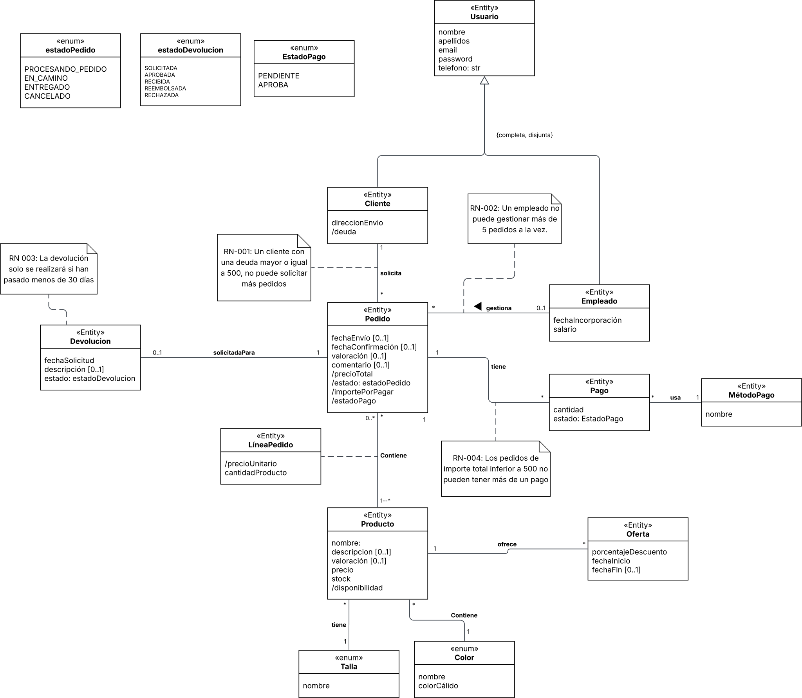

# Tienda de ropa en línea KUMAFU

## Miembros del grupo L1-DF-AM-1 (2026)

1. Moguel Prado, José
2. Lázaro Marín, Rubén
3. Ramírez Fabra, Javier
4. Sicard Muñoz, Carlos

## 1. Introducción al problema

Este proyecto tiene como objetivo diseñar y desarrollar el sistema de información de KUMAFU, una tienda en línea especializada en la venta de ropa, como sudaderas, camisetas y pantalones. El negocio busca digitalizar y automatizar su proceso de venta y mejorar la interacción con los proveedores, encargados de abastecer el inventario, y con los clientes, que utilizarán una interfaz web.

La tienda contará con:

1. Proveedores internos y externos que suministrarán los productos.
2. Una interfaz para realizar pedidos.
3. Opciones para solicitar devoluciones y enviar valoraciones.

### Situación actual y problemas detectados

El principal problema de la gestión actual de la tienda son los cuellos de botella operativos, que dificultan su crecimiento y escalabilidad.

1. **Falta de trazabilidad de las ventas:** No hay un proceso claro para hacer seguimiento de las compras. Los clientes tampoco disponen de un carrito persistente que conserve su estado (activo, abandonado o convertido en pedido).
2. **Gestión manual de pagos y estados:** El procesamiento de los pagos y el seguimiento de los pedidos (desde el pago pendiente hasta la entrega o devolución) carecen de automatización y de trazabilidad financiera.
3. **Gestión ineficiente de las devoluciones:** El proceso no está definido con suficiente claridad, lo que puede generar conflictos con los plazos y disputas sobre los reembolsos.
4. **Falta de valoraciones:** La tienda no dispone de un sistema integrado para conocer la satisfacción de los clientes con los productos adquiridos.

### Expectativas y solución propuesta

Para resolver estas carencias, se desarrollará un sistema integral que cubra el ciclo de vida de la compra. La solución incluirá:

- **Gestión de usuarios y catálogo:** Los usuarios registrados podrán consultar un catálogo de productos con tallas (de XS a XL y talla única) y colores disponibles. El sistema controlará el stock de cada producto.
- **Proceso de compra:** El sistema ofrecerá un carrito temporal que podrá convertirse en un pedido. También registrará los pagos y permitirá utilizar distintos métodos, como Visa, Mastercard, PayPal, Apple Pay y Google Pay.
- **Gestión de devoluciones:** Habrá un módulo para solicitar devoluciones y gestionar reembolsos. Las solicitudes podrán realizarse durante los 30 días posteriores a la compra.
- **Valoraciones y ofertas:** Los usuarios podrán valorar los productos del 1 al 5 y dejar un comentario. Además, el sistema ofrecerá promociones temporales con descuentos aplicados al precio de los productos.

## 2. Glosario de términos

Este glosario recoge los términos del dominio de KUMAFU necesarios para comprender la lógica del negocio y las entidades del modelo:

- **Carrito de compra:** Contenedor temporal que agrupa los productos que un usuario desea adquirir. Puede estar activo, abandonado o convertido en un pedido.
- **Devolución:** Proceso iniciado por el usuario para devolver un pedido y solicitar un reembolso. La solicitud debe realizarse durante los 30 días posteriores a la compra.
- **Ítem de carrito:** Línea del carrito que indica un producto y la cantidad que el usuario desea adquirir. Todo carrito debe contener al menos un ítem.
- **Oferta:** Promoción con fechas de inicio y fin que aplica un descuento superior a cero a determinados productos del catálogo.
- **Pago:** Transacción económica asociada a un pedido. Incluye un identificador de transacción y se realiza mediante alguno de los métodos de pago admitidos.
- **Pedido:** Registro que confirma la intención de compra del usuario. Agrupa los productos seleccionados y calcula el total a partir de sus precios en el momento de la compra.
- **Valoración:** Opinión de un usuario sobre un producto adquirido, compuesta por una puntuación del 1 al 5 y un comentario. Debe aprobarse antes de hacerse pública.
- **Gastos de envío:** Coste adicional que se abonará al realizar un pedido a domicilio.
- **Marketing:** Pûblicidad o técnicas que utiliza la marca para promocionarse.
- **Talla:** Tamaño o medida de una prenda o accesorio.
- **Producto o prenda:** Artículo de ropa que vende KUMAFU. Tiene una talla de XS a XL o talla única, un color, un precio actual y una cantidad disponible en el almacén, que no puede ser negativa.

- **Baggy:** Tallaje de la prenda más holgada de lo normal.

- **Denim:** Tono del color de un pantalón vaquero.

- **Oversize:** Tallaje de una prenda más larga o grande de lo normal.

- **Cargo:** Tipo de pantalón con varios bolsillos. Tienen más volumen de tamaño.

- **Hoodie:** Término con el cual podemos referir a una sudadera con capucha.

- **Joggers:** Tipo de pantalón largo el cual está ajustado en la zona de los tobillos.

## 3. Visión general del sistema

### 3.1. Requisitos generales

#### OBJ-001: Gestionar las cuentas de usuario
- **Como:** Administrador.
- **Quiero:** Tener la capacidad para gestionar la información de la cuenta de todos los usuarios.
- **Para:** Conocer la informacion del cliente y posibles eliminaciones de usuario.

#### OBJ-002: Gestionar su cuenta un usuario
- **Como:** Cliente.
- **Quiero:** Tener la capacidad para gestionar la información de su propia cuenta.
- **Para:** Su uso en los pedidos a realizar (dirección deseada, horarios de llegada del pedido, etc.).

#### OBJ-003: Gestionar los pedidos
- **Como:** Encargado de almacén.
- **Quiero:** Ofrecer un servicio de entrega fiable y seguro,tener un recuento de los productor del pedido y manteniendo un seguimiento del mismo.
- **Para:** Que el cliente pueda recibirlo sin deterioro ninguno y pueda estimar la fecha de llegada del mismo.

#### OBJ-004: Gestionar los productos
- **Como:** Gerente de la tienda.
- **Quiero:** Mantener actualizado el stock las prendas que se encuentran disponibles.
- **Para:** Que el cliente conozca la disponibilidad del producto y el stock restante del mismo.

#### OBJ-005: Gestionar las devoluciones
- **Como:** Gerente de la tienda.
- **Quiero:** Ofrecer un servicio seguro y eficaz de devoluciones.
- **Para:** Que el cliente disponga de facilidades si hay algún problema con el envío o el reparto (producto defectuoso, mensajes de envío realizado fraudulentos, etc.).

#### OBJ-006: Gestionar las devoluciones
- **Como:** Cliente.
- **Quiero:** Tener la capacidad para valorar la calidad del encvío y producto.
- **Para:** Mostrar mi descontento o aprobación con el servicio recibido.

### 3.2. Usuarios del sistema

- Administrador: Gestiona la configuración del sistema y tiene la totalidad de su control.

- Gerente de la tienda: Supervisa el día a día, revisa que prendas son las más vendidas y controla que haya stock suficiente de las prendas.

- Encargado de almacén: Recibe la mercancía nueva y se encarga de revisar su calidad, ingresa las prendas con sus respectivos códigos de barras y talla y prepara los pedidos para su envío.

- Cliente: Podrá realizar pedidos, navegar por la web,proponer una ubicación donde se entregará su pedido si así lo desea y realizar devoluciones si está dentro del plazo delimitado de 30 días.

- Empresa de envío: Tendrá la información del cliente para saber dónde entregar el pedido y a nombre de quién para que no haya problemas de entrega a otras personas, equivocaciones, etc. 

## 4. Catálogo de requisitos

### 4.1. Requisitos funcionales

#### R.F.1.1. Crear cuentas de usuario

- **Como:** administrador.
- **Quiero:** registrar nuevas cuentas de usuario, indicando sus datos y si corresponden a clientes o empleados.
- **Para:** dar acceso al sistema a los usuarios de la tienda.

**Pruebas de aceptación**

- Al introducir los datos obligatorios, se crea la cuenta con el tipo de usuario seleccionado.
- Si faltan datos obligatorios, se informa del problema y no se crea la cuenta.
- La cuenta creada aparece en la consulta de usuarios.

#### R.F.1.2. Consultar cuentas de usuario

- **Como:** administrador.
- **Quiero:** consultar las cuentas de los usuarios y sus datos.
- **Para:** disponer de la información de los clientes y empleados de la tienda.

**Pruebas de aceptación**

- Se muestra el listado de usuarios registrados.
- Al seleccionar un usuario, se muestran sus datos y su tipo de cuenta.
- Si no hay usuarios registrados, se informa de que no hay resultados.

#### R.F.1.3. Modificar cuentas de usuario

- **Como:** administrador.
- **Quiero:** modificar los datos de las cuentas de usuario.
- **Para:** mantener actualizada la información de los clientes y empleados.

**Pruebas de aceptación**

- Al seleccionar una cuenta e introducir datos válidos, se guardan los cambios.
- Si se deja vacío un dato obligatorio, se informa del problema y se conserva la información anterior.
- Al consultar de nuevo la cuenta, se muestran los datos actualizados.

#### R.F.1.4. Eliminar cuentas de usuario

- **Como:** administrador.
- **Quiero:** dar de baja cuentas de usuario.
- **Para:** retirar el acceso a quienes ya no deban utilizar el sistema.

**Pruebas de aceptación**

- Se solicita confirmación antes de dar de baja una cuenta.
- Si se confirma la baja, la cuenta deja de permitir el acceso al sistema.
- Si se cancela la operación, la cuenta permanece activa.
- La baja conserva la información histórica de los pedidos asociados.

#### R.F.2.1. Crear mi cuenta de cliente

- **Como:** cliente.
- **Quiero:** registrarme introduciendo mis datos personales y de acceso.
- **Para:** disponer de una cuenta con la que realizar y consultar mis compras.

**Pruebas de aceptación**

- Al introducir los datos obligatorios, se crea una cuenta de cliente.
- Si faltan datos obligatorios, se informa del problema y no se completa el registro.
- Una vez creada la cuenta, el cliente puede acceder a ella con sus credenciales.

#### R.F.2.2. Consultar mi cuenta de cliente

- **Como:** cliente.
- **Quiero:** consultar mis datos personales, mi dirección de envío y mis métodos de pago guardados.
- **Para:** comprobar la información disponible para realizar mis pedidos.

**Pruebas de aceptación**

- El cliente puede consultar únicamente los datos de su propia cuenta.
- Se muestran sus datos personales y su dirección de envío.
- Se muestran sus métodos de pago guardados, identificando las tarjetas mediante su marca y sus cuatro últimos dígitos.
- Si no tiene métodos de pago guardados, se informa de ello.

#### R.F.2.3. Modificar mi cuenta de cliente

- **Como:** cliente.
- **Quiero:** modificar mis datos personales y mi dirección de envío.
- **Para:** mantener actualizada la información utilizada en mis próximas compras.

**Pruebas de aceptación**

- El cliente puede modificar únicamente los datos de su propia cuenta.
- Al introducir datos válidos, los cambios se guardan y aparecen en las consultas posteriores.
- Si se deja vacío un dato obligatorio, se informa del problema y se conserva la información anterior.
- El cambio de dirección no modifica la dirección de entrega de los pedidos ya confirmados.

#### R.F.2.4. Eliminar mi cuenta de cliente

- **Como:** cliente.
- **Quiero:** dar de baja mi cuenta.
- **Para:** dejar de utilizar mi cuenta en la tienda.

**Pruebas de aceptación**

- El cliente puede solicitar la baja únicamente de su propia cuenta.
- Se solicita confirmación antes de realizar la baja.
- Al confirmar la operación, la cuenta deja de permitir el acceso al sistema.
- Si se cancela la operación, la cuenta permanece activa.
- Se conserva la información histórica de los pedidos asociados.

#### R.F.3.1. Crear pedidos

- **Como:** encargado de almacén.
- **Quiero:** registrar un pedido asociado a un cliente, indicando sus productos y cantidades.
- **Para:** disponer de la información necesaria para preparar su envío.

**Pruebas de aceptación**

- Al introducir datos válidos, se crea un pedido asociado al cliente seleccionado.
- El pedido contiene al menos una línea con un producto y una cantidad entera positiva.
- Si alguna cantidad solicitada supera el stock disponible, se informa del problema y no se registra el pedido.
- Si el cliente tiene una deuda mayor o igual a 500 euros, se rechaza la creación del pedido conforme a R.N.001.
- Si la asignación del pedido a un empleado incumple R.N.002, se rechaza dicha asignación.

#### R.F.3.2. Consultar pedidos

- **Como:** encargado de almacén.
- **Quiero:** consultar los pedidos, sus detalles y el empleado encargado de gestionarlos, con filtros por empleado y estado.
- **Para:** organizar la preparación de los envíos y realizar su seguimiento.

**Pruebas de aceptación**

- Para cada pedido se muestran su identificador, cliente, estado y empleado asignado.
- Al consultar el detalle, se muestran los productos, sus cantidades, el importe total y las fechas de confirmación y envío cuando existan.
- La consulta permite conocer los pagos registrados y el importe pendiente del pedido.
- Al filtrar por empleado y estado, se muestran únicamente los pedidos que cumplen ambos criterios.
- Si ningún pedido cumple los filtros, se informa de que no hay resultados.

#### R.F.3.3. Modificar pedidos

- **Como:** encargado de almacén.
- **Quiero:** actualizar el estado, la información de envío y el empleado asignado a un pedido.
- **Para:** reflejar el avance de su preparación y entrega.

**Pruebas de aceptación**

- Al modificar un pedido con datos válidos, los cambios quedan registrados.
- Al registrar su envío, se guarda la fecha de envío correspondiente.
- Si un cambio de empleado incumple R.N.002, se rechaza la reasignación y se conserva el empleado anterior.
- Al consultar nuevamente el pedido, se muestra la información actualizada.

#### R.F.3.4. Eliminar pedidos

- **Como:** encargado de almacén.
- **Quiero:** eliminar pedidos registrados por error que todavía no se hayan confirmado ni tengan pagos asociados.
- **Para:** corregir registros incorrectos antes de iniciar su tramitación.

**Pruebas de aceptación**

- Se solicita confirmación antes de eliminar un pedido.
- Si el pedido no está confirmado ni tiene pagos asociados, se elimina junto con sus líneas.
- Si el pedido está confirmado o tiene pagos asociados, se rechaza la eliminación y se informa del motivo.
- Si se cancela la operación, el pedido permanece sin cambios.

#### R.F.4.1. Crear productos

- **Como:** gerente de la tienda.
- **Quiero:** registrar nuevos productos con su nombre, descripción, talla, color, precio y stock.
- **Para:** incorporar nuevas prendas al catálogo.

**Pruebas de aceptación**

- Al introducir los datos obligatorios y válidos, se registra el producto.
- El precio debe ser mayor que cero y el stock debe ser un número entero mayor o igual que cero.
- Si faltan datos obligatorios o se introducen valores no válidos, se informa del problema y no se crea el producto.
- El producto creado aparece en la consulta del catálogo.

#### R.F.4.2. Consultar productos

- **Como:** gerente de la tienda.
- **Quiero:** consultar los productos y sus existencias, con filtros por tipo de prenda, talla, color y disponibilidad.
- **Para:** conocer el estado del catálogo y detectar los productos agotados.

**Pruebas de aceptación**

- Para cada producto se muestran su nombre, descripción, talla, color, precio y stock.
- Al aplicar varios filtros, se muestran únicamente los productos que cumplen todos los criterios seleccionados.
- Al consultar productos agotados, se muestran únicamente aquellos cuyo stock es cero.
- Si ningún producto cumple los filtros, se informa de que no hay resultados.

#### R.F.4.3. Modificar productos

- **Como:** gerente de la tienda.
- **Quiero:** modificar los datos y el stock de los productos.
- **Para:** mantener actualizado el catálogo y la disponibilidad de las prendas.

**Pruebas de aceptación**

- Al seleccionar un producto e introducir datos válidos, se guardan los cambios.
- Se rechazan los cambios que establezcan un precio menor o igual que cero o un stock negativo.
- Se permite establecer el stock en cero para reflejar que el producto está agotado.
- Al consultar nuevamente el producto, se muestran los datos actualizados.

#### R.F.4.4. Eliminar productos

- **Como:** gerente de la tienda.
- **Quiero:** retirar productos del catálogo.
- **Para:** dejar de ofrecer prendas que ya no se comercializan.

**Pruebas de aceptación**

- Se solicita confirmación antes de retirar un producto.
- Una vez retirado, el producto deja de estar disponible para nuevos pedidos.
- Los pedidos anteriores conservan la información del producto retirado.
- Si se cancela la operación, el producto permanece disponible en las mismas condiciones.

#### R.F.5.1. Crear solicitudes de devolución

- **Como:** gerente de la tienda.
- **Quiero:** registrar una solicitud de devolución asociada al pedido de un cliente.
- **Para:** iniciar la gestión de las incidencias comunicadas por el cliente.

**Pruebas de aceptación**

- Al seleccionar un pedido válido, se registra la solicitud con su fecha, descripción si se proporciona y estado inicial.
- La solicitud queda asociada al pedido seleccionado.
- Se permite registrar la solicitud si han transcurrido menos de 30 días desde la fecha del pedido, conforme a R.N.003.
- Si han transcurrido 30 días o más, se rechaza la solicitud y se informa del motivo.

#### R.F.5.2. Consultar solicitudes de devolución

- **Como:** gerente de la tienda.
- **Quiero:** consultar las solicitudes de devolución y filtrarlas por estado.
- **Para:** conocer las incidencias pendientes y realizar su seguimiento.

**Pruebas de aceptación**

- Para cada solicitud se muestran el pedido asociado, el cliente, la fecha de solicitud y el estado.
- Al seleccionar una solicitud, se muestra su descripción si se ha proporcionado.
- Al filtrar por estado, se muestran únicamente las solicitudes que coinciden con el estado seleccionado.
- Si no existen solicitudes que cumplan los criterios, se informa de que no hay resultados.

#### R.F.5.3. Modificar solicitudes de devolución

- **Como:** gerente de la tienda.
- **Quiero:** actualizar el estado y la descripción de las solicitudes de devolución.
- **Para:** reflejar el avance de su gestión y completar la información de las incidencias.

**Pruebas de aceptación**

- Al seleccionar una solicitud e introducir cambios válidos, se guarda la información actualizada.
- La modificación conserva el pedido asociado y la fecha original de solicitud.
- Al consultar nuevamente la solicitud, se muestran los cambios realizados.
- Si se cancela la modificación, se conserva la información anterior.

#### R.F.5.4. Eliminar solicitudes de devolución

- **Como:** gerente de la tienda.
- **Quiero:** eliminar solicitudes registradas por error cuya tramitación todavía no haya comenzado.
- **Para:** evitar la gestión de solicitudes incorrectas o duplicadas.

**Pruebas de aceptación**

- Se solicita confirmación antes de eliminar una solicitud.
- Si su tramitación no ha comenzado, la solicitud se elimina y deja de aparecer en las consultas.
- Si su tramitación ya ha comenzado, se rechaza la eliminación y se informa del motivo.
- La eliminación de la solicitud no elimina el pedido asociado.

#### R.F.6.1. Crear valoraciones

- **Como:** cliente.
- **Quiero:** registrar una puntuación y un comentario sobre un pedido recibido.
- **Para:** expresar mi satisfacción con los productos y el servicio de entrega.

**Pruebas de aceptación**

- El cliente puede valorar únicamente sus propios pedidos recibidos.
- Se permite registrar una puntuación entera entre 1 y 5 y un comentario.
- Si la puntuación está fuera del rango permitido, se rechaza la valoración y se informa del problema.
- Si el pedido ya tiene una valoración, se indica que debe modificar la existente.

#### R.F.6.2. Consultar valoraciones

- **Como:** cliente.
- **Quiero:** consultar las valoraciones que he realizado sobre mis pedidos.
- **Para:** revisar las opiniones que he registrado sobre mis compras.

**Pruebas de aceptación**

- La consulta muestra únicamente las valoraciones realizadas por el cliente.
- Para cada valoración se muestran el pedido asociado, la puntuación y el comentario.
- Al consultar un pedido sin valoración, se informa de que todavía no se ha valorado.
- Si el cliente no ha realizado ninguna valoración, se informa de ello.

#### R.F.6.3. Modificar valoraciones

- **Como:** cliente.
- **Quiero:** modificar la puntuación y el comentario de mis valoraciones.
- **Para:** corregir o actualizar mi opinión sobre una compra.

**Pruebas de aceptación**

- El cliente puede modificar únicamente sus propias valoraciones.
- Al introducir una puntuación entera entre 1 y 5, se guardan los cambios.
- Si la puntuación no es válida, se rechaza la modificación y se conserva la valoración anterior.
- Al consultar nuevamente la valoración, se muestran la puntuación y el comentario actualizados.

#### R.F.6.4. Eliminar valoraciones

- **Como:** cliente.
- **Quiero:** eliminar las valoraciones que he realizado.
- **Para:** retirar una opinión que ya no deseo mantener registrada.

**Pruebas de aceptación**

- El cliente puede eliminar únicamente sus propias valoraciones.
- Se solicita confirmación antes de eliminar una valoración.
- Al confirmar la eliminación, el pedido deja de tener la puntuación y el comentario asociados.
- La eliminación de la valoración no elimina ni modifica el resto de los datos del pedido.
- Si se cancela la operación, la valoración permanece sin cambios.

#### 4.1.1. Requisitos de información

##### R.I.01. Registro de usuarios, clientes y empleados

- **Como:** Administrador
- **Quiero:** registrar los datos de los usuarios (nombre, apellidos, email, contraseña y teléfono) y distinguir entre clientes y empleados. Para los clientes, también quiero registrar la dirección de envío
- **Para:** gestionar las cuentas y disponer de la información necesaria para los pedidos y la gestión de la tienda.

**Pruebas de aceptación**

- Comprobar que se almacenan los atributos definidos para la clase **Usuario**.
- Comprobar que cada cliente dispone de una dirección de envío.
- Comprobar que el email introducido por el usuario contenga el carácter **"@"**, según la regla de negocio correspondiente (R.N.001).
- Comprobar que se puede consultar la deuda del cliente como un valor calculado, no como un dato almacenado.

##### R.I.02. Registro de productos y ofertas

- **Como:** Encargado de almacén
- **Quiero:** registrar y actualizar los datos de cada producto (nombre, descripción, talla, precio actual, stock, color y disponibilidad), así como las ofertas aplicadas a estos (porcentaje de descuento, fecha de inicio y fin).
- **Para:** asegurar que el cliente vea el inventario real y compre con los precios y promociones correctos en cada momento.

**Pruebas de aceptación**

- Comprobar que se pueden almacenar los datos definidos para **Producto**.
- Comprobar que el sistema no permite guardar un producto con precio o stock con valor igual o inferior a cero. Se deben cumplir las reglas de negocio correspondientes (R.N.002 y R.N.011).
- Comprobar que, cuando se informan ambas fechas de la oferta, la fecha de fin es posterior a la de inicio.

##### R.I.03. Registro de pedidos y pagos

- **Como:** Cliente
- **Quiero:** que el sistema registre los pedidos, sus fechas de envío y confirmación, su estado y los pagos asociados, incluidos su cantidad, estado y método de pago.
- **Para:** consultar el estado de mis pedidos y la información de los pagos resgistrados.

**Pruebas de aceptación**

- Comprobar que el pedido puede asociarse a un cliente y a los pagos correspondientes.
- Comprobar que se registran la fecha de envío, la fecha de confirmación y el estado del pedido cuando corresponda.
- Comprobar que cada pago almacena la cantidad y el estado definidos en **Pago**, y que se asocia a un método de pago.
- Comprobar que el total del pedido y el importe por pagar se obtienen de acuerdo con los atributos derivados del diagrama.

##### R.I.04. Registro del detalle de los pedidos

- **Como:** Cliente
- **Quiero:** que el sistema registre las líneas de cada pedido, indicando el producto y la cantidad correspondiente.
- **Para:** conocer qué productos forman parte del pedido y cómo se obtiene su importe.

**Pruebas de aceptación**

- Comprobar que un pedido puede contener una o varias líneas de pedido.
- Comprobar que el precio unitario y total se calculan conforme a los atributos derivados.
- Comprobar que la cantidad solicitada es positiva y no supera el stock disponible.

##### R.I.05. Registro de devoluciones y datos de valoración del pedido

- **Como:** Cliente 
- **Quiero:** que el sistema registre las devoluciones asociadas a mis pedidos con su fecha de solicitud, descripción y estado, y que permita guardar la valoración y el comentario asociados al pedido. 
- **Para:** realizar el seguimiento de las devoluciones y registrar mi opinión sobre la compra.

**Pruebas de aceptación**

- Comprobar que una devolución está asociada a un pedido y registra la fecha de solicitud, el estado y, si se proporciona, la descripción.
- Comprobar que la valoración y el comentario pueden registrarse como datos opcionales del pedido.
- Comprobar que la fecha de solicitud de la devolución tiene una diferencia menor a 30 días respecto a la fecha del pedido asociado. Se debe cumplir la regla de negocio R.N.006.
- Comprobar que la calificación numérica asignada en la valoración se restringe estrictamente al rango del 1 al 5. Se debe cumplir la regla de negocio R.N.005.

#### 4.1.2. Reglas de negocio

##### R.N.001. Evitar compra de clientes con alta deuda

Como jefe de Kumafu,
quiero los clientes con una deuda mayor o igual 500 no puedan solicitar más pedidos, para garantizar que solo puedan comprar las personas que acaban pagando sus deudas.

##### R.N.002. Limitación de gestiones de pedido

Como jefe de recursos humanos,
quiero que los empleados no puedan gestionar más de 5 pedidos, para evitar sobrecarga de trabajo y garantizar la gestión de cada pedido de la forma más centrada posible.

##### R.N.003. Tiempo de devolución

Como director de marketing,
quiero que solo se pueda devolver un producto si han pasado menos de 30 días, para no dar un márgen de prueba de los productos Kumafu demasiado alto.

##### R.N.004. Limitaciones de pagos múltiples

Como jefe de Kumafu,
quiero prohibir que los pedidos de importe total inferior a 500 euros se hagan con más de un pago, para reducir el número de deudas a la venta al pormenor.

### 4.2. Mapa de historias de usuario (opcional)

### 4.3. Requisitos no funcionales (opcional)

**R.N.F.01. Título del requisito no funcional**

- **Como:** [tipo de usuario]
- **Quiero:** [servicio]
- **Para:** [razón]

---

## 5. Modelo conceptual

### 5.1. Diagramas de clases UML

### 5.2. Escenarios de prueba

Cada escenario debe incluir una descripción textual y un diagrama de objetos UML.

## 6. Matrices de trazabilidad

Matriz de trazabilidad entre los elementos del modelo conceptual y los requisitos:

|      | Entidad X | Asociación X | Restricción X | Entidad 2... |
| :--- | :-------- | :----------- | :------------ | :----------- |
| RI-1 | X         | X            | X             | X            |
| RI-2 |           | X            |               | X            |
| RF-1 |           | X            |               | X            |
| RF-2 | X         |              | X             | X            |
| RN-1 |           | X            |               |              |
| RN-2 | X         | X            | X             |              |
| ...  |           |              |               |              |

---

## 7. Modelo relacional en 3FN

Relaciones obtenidas al transformar el modelo conceptual.

### 7.1. Justificación de la estrategia de transformación de jerarquías

Si se identificaron jerarquías en el modelo conceptual, se debe justificar la estrategia utilizada para transformarlas.

## 8. Matriz de trazabilidad entre el modelo conceptual y SQL (opcional)

La matriz debe relacionar las restricciones del modelo conceptual con los elementos del modelo tecnológico en SQL, como disparadores y restricciones declarativas. Para el entregable 3, se deben incluir las reglas de negocio y su implementación mediante restricciones o disparadores.

|         | Entidad X | Asociación X | Restricción X | Entidad 2... |
| :------ | :-------- | :----------- | :------------ | :----------- |
| TABLA-1 |           |              |               |              |
| TABLA-2 |           |              |               |              |
| TABLA-3 |           |              |               |              |
| TABLA-4 |           |              |               |              |
| TRIG-1  |           |              |               |              |
| TRIG-2  | X         | X            |               | X            |
| TRIG-3  |           | X            |               | X            |
| TRIG-4  |           |              | X             |              |
| CONST-1 |           |              |               |              |
| CONST-2 | X         | X            |               | X            |
| CONST-3 |           | X            |               | X            |
| CONST-4 |           |              | X             |              |

Se consideran todos los tipos de restricciones declarativas, es decir, las definidas en las instrucciones `CREATE TABLE`.

---

## Referencias
