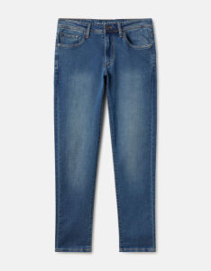
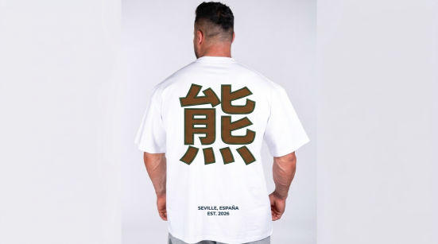
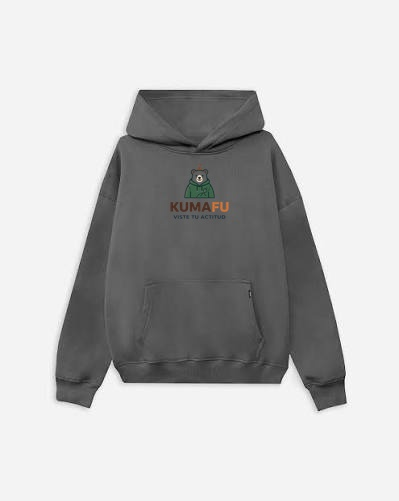
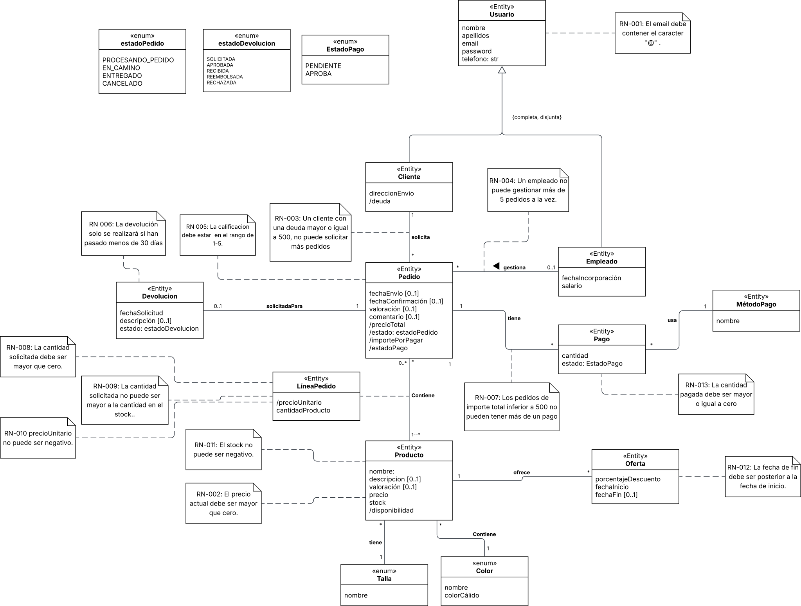

# Tienda de ropa en línea KUMAFU

## Miembros del grupo L1-DF-AM-1 (2026)

1. Moguel Prado, José
2. Lázaro Marín, Rubén
3. Ramírez Fabra, Javier
4. Apellidos, Nombre

## 1. Introducción al problema

Este proyecto tiene como objetivo diseñar y desarrollar el sistema de información de KUMAFU, una tienda en línea especializada en la venta de ropa, como sudaderas, camisetas y pantalones. El negocio busca digitalizar y automatizar su proceso de venta y mejorar la interacción con los proveedores, encargados de abastecer el inventario, y con los clientes, que utilizarán una interfaz web.

La tienda contará con:

1. Proveedores internos y externos que suministrarán los productos.
2. Una interfaz para realizar pedidos.
3. Opciones para solicitar devoluciones y enviar valoraciones.

### Situación actual y problemas detectados

El principal problema de la gestión actual de la tienda son los cuellos de botella operativos, que dificultan su crecimiento y escalabilidad.

1. **Falta de trazabilidad de las ventas:** No hay un proceso claro para hacer seguimiento de las compras. Los clientes tampoco disponen de un carrito persistente que conserve su estado (activo, abandonado o convertido en pedido).
2. **Gestión manual de pagos y estados:** El procesamiento de los pagos y el seguimiento de los pedidos (desde el pago pendiente hasta la entrega o devolución) carecen de automatización y de trazabilidad financiera.
3. **Gestión ineficiente de las devoluciones:** El proceso no está definido con suficiente claridad, lo que puede generar conflictos con los plazos y disputas sobre los reembolsos.
4. **Falta de valoraciones:** La tienda no dispone de un sistema integrado para conocer la satisfacción de los clientes con los productos adquiridos.

### Expectativas y solución propuesta

Para resolver estas carencias, se desarrollará un sistema integral que cubra el ciclo de vida de la compra. La solución incluirá:

- **Gestión de usuarios y catálogo:** Los usuarios registrados podrán consultar un catálogo de productos con tallas (de XS a XL y talla única) y colores disponibles. El sistema controlará el stock de cada producto.
- **Proceso de compra:** El sistema ofrecerá un carrito temporal que podrá convertirse en un pedido. También registrará los pagos y permitirá utilizar distintos métodos, como Visa, Mastercard, PayPal, Apple Pay y Google Pay.
- **Gestión de devoluciones:** Habrá un módulo para solicitar devoluciones y gestionar reembolsos. Las solicitudes podrán realizarse durante los 30 días posteriores a la compra.
- **Valoraciones y ofertas:** Los usuarios podrán valorar los productos del 1 al 5 y dejar un comentario. Además, el sistema ofrecerá promociones temporales con descuentos aplicados al precio de los productos.

## 2. Glosario de términos

Este glosario recoge los términos del dominio de KUMAFU necesarios para comprender la lógica del negocio y las entidades del modelo:

- **Carrito de compra:** Contenedor temporal que agrupa los productos que un usuario desea adquirir. Puede estar activo, abandonado o convertido en un pedido.
- **Devolución:** Proceso iniciado por el usuario para devolver un pedido y solicitar un reembolso. La solicitud debe realizarse durante los 30 días posteriores a la compra.
- **Ítem de carrito:** Línea del carrito que indica un producto y la cantidad que el usuario desea adquirir. Todo carrito debe contener al menos un ítem.
- **Oferta:** Promoción con fechas de inicio y fin que aplica un descuento superior a cero a determinados productos del catálogo.
- **Pago:** Transacción económica asociada a un pedido. Incluye un identificador de transacción y se realiza mediante alguno de los métodos de pago admitidos.
- **Pedido:** Registro que confirma la intención de compra del usuario. Agrupa los productos seleccionados y calcula el total a partir de sus precios en el momento de la compra.
- **Valoración:** Opinión de un usuario sobre un producto adquirido, compuesta por una puntuación del 1 al 5 y un comentario. Debe aprobarse antes de hacerse pública.
- **Gastos de envío:** Coste adicional que se abonará al realizar un pedido a domicilio.
- **Marketing:** Pûblicidad o técnicas que utiliza la marca para promocionarse.
- **Talla:** Tamaño o medida de una prenda o accesorio.
- **Producto o prenda:** Artículo de ropa que vende KUMAFU. Tiene una talla de XS a XL o talla única, un color, un precio actual y una cantidad disponible en el almacén, que no puede ser negativa.

- **Baggy:** Tallaje de la prenda más holgada de lo normal.

- **Denim:** Tono del color de un pantalón vaquero.

- **Oversize:** Tallaje de una prenda más larga o grande de lo normal.

- **Cargo:** Tipo de pantalón con varios bolsillos. Tienen más volumen de tamaño.

- **Hoodie:** Término con el cual podemos referir a una sudadera con capucha.

- **Joggers:** Tipo de pantalón largo el cual está ajustado en la zona de los tobillos.

## 3. Visión general del sistema

### 3.1. Requisitos generales

OBJ-001: Gestionar las cuentas de usuario

    Como propietario o cliente de KUMAFU:

    Quiero tener la capacidad para gestionar la información de la cuenta, para su uso en los pedidos a realizar.

OBJ-002: Gestionar los pedidos

    Como propietario de KUMAFU:

    Quiero ofrecer un servicio de entrega fiable y seguro, manteniendo un seguimiento de su pedido, para que el cliente pueda recibirlo sin deterioro ninguno y pueda estimar la fecha de llegada del mismo.

OBJ-003: Gestionar los productos

    Como propietario de KUMAFU:

    Quiero mantener actualizado las prendas que se encuentran disponibles para que el cliente conozca la disponibilidad del producto y el stock restante del mismo.

OBJ-004: Gestionar las devoluciones

    Como propietario de KUMAFU:

    Quiero ofrecer un servicio seguro y eficaz de devoluciones, para que el cliente disponga de facilidades si hay algún problema con el producto y/o reparto.

### 3.2. Usuarios del sistema

- Administrador: Gestiona la configuración del sistema y tiene la totalidad de su control.

- Gerente de la tienda: Supervisa el día a día, revisa que prendas son las más vendidas y controla que haya stock suficiente de las prendas.

- Encargado de almacén: Recibe la mercancía nueva y se encarga de revisar su calidad, ingresa las prendas con sus respectivos códigos de barras y talla y prepara los pedidos para su envío.

- Cliente: Podrá realizar pedidos, navegar por la web,proponer una ubicación donde se entregará su pedido si así lo desea y realizar devoluciones si está dentro del plazo delimitado de 30 días.

- Empresa de envío: Tendrá la información del cliente para saber dónde entregar el pedido y a nombre de quién para que no haya problemas de entrega a otras personas, equivocaciones, etc. 

## 4. Catálogo de requisitos

### 4.1. Requisitos funcionales

#### R.F.01. Consultar el catálogo de productos

- **Como:** cliente.
- **Quiero:** consultar los productos del catálogo y filtrarlos por tipo de prenda, talla y color.
- **Para:** encontrar prendas que se ajusten a mis preferencias y conocer su disponibilidad y precio.

**Pruebas de aceptación**

- Al consultar el catálogo sin filtros, se muestran todos los productos del catálogo.
- Al aplicar varios filtros, se muestran únicamente los productos que cumplen todos los criterios seleccionados.
- Para cada producto se muestran su nombre, talla, color, precio y disponibilidad.
- Si ningún producto cumple los filtros, se informa de que no hay resultados.

#### R.F.02. Consultar el historial y el detalle de los pedidos

- **Como:** cliente.
- **Quiero:** consultar mis pedidos y acceder al detalle de cada uno.
- **Para:** conocer qué he comprado y en qué estado se encuentra cada pedido.

**Pruebas de aceptación**

- El listado muestra únicamente los pedidos del cliente que realiza la consulta, ordenados desde el más reciente.
- Para cada pedido se muestran su identificador, fecha, importe total y estado.
- Al consultar su detalle, se muestran los productos, sus cantidades y los precios que tenían en el momento de la compra.
- Si el cliente no tiene pedidos, se informa de que su historial está vacío.

#### R.F.03. Consultar las existencias de productos

- **Como:** encargado de almacén.
- **Quiero:** consultar las existencias de los productos por talla y color.
- **Para:** conocer las unidades disponibles y detectar los productos agotados.

**Pruebas de aceptación**

- La consulta muestra la cantidad disponible de cada producto, identificando su talla y color.
- Al filtrar por un producto, se muestran únicamente las existencias correspondientes a ese producto.
- Al consultar los productos agotados, se muestran únicamente aquellos cuyo stock es cero.
- Si ningún producto cumple los criterios seleccionados, se informa de que no hay resultados.

#### R.F.04. Consultar los pagos y el importe pendiente de un pedido

- **Como:** cliente.
- **Quiero:** consultar los pagos registrados de mis pedidos y su importe pendiente.
- **Para:** comprobar cuánto he pagado y cuánto queda por abonar.

**Pruebas de aceptación**

- El cliente puede consultar únicamente los pagos de sus propios pedidos.
- Para cada pago se muestran su identificador de transacción, importe y método de pago.
- Para un pedido de 600 euros con un pago registrado de 200 euros, se muestran 200 euros abonados y 400 euros pendientes.
- Si un pedido no tiene pagos registrados, se informa de ello y su importe pendiente coincide con el total del pedido.
- Si el pedido está completamente pagado, su importe pendiente es cero.

#### R.F.05. Consultar los pedidos gestionados por un empleado

- **Como:** gerente de la tienda.
- **Quiero:** consultar los pedidos gestionados por un empleado y filtrarlos por estado.
- **Para:** supervisar la distribución del trabajo y el seguimiento de los pedidos.

**Pruebas de aceptación**

- Al seleccionar un empleado, se muestran únicamente los pedidos que tiene asociados.
- Para cada pedido se muestran su identificador, fecha y estado.
- Al seleccionar un estado, se muestran únicamente los pedidos del empleado que se encuentran en ese estado.
- Si el empleado no tiene pedidos que cumplan los criterios, se informa de que no hay resultados.

#### R.F.06. Consultar las solicitudes de devolución

- **Como:** cliente.
- **Quiero:** consultar mis solicitudes de devolución y su estado.
- **Para:** realizar un seguimiento de las devoluciones que he solicitado.

**Pruebas de aceptación**

- El listado muestra únicamente las solicitudes de devolución del cliente que realiza la consulta.
- Para cada solicitud se muestran el pedido asociado, la fecha de solicitud y su estado.
- Al seleccionar una solicitud, se muestra la información correspondiente a esa devolución.
- Si el cliente no ha solicitado devoluciones, se informa de que no hay solicitudes registradas.

#### R.F.07. Consultar las valoraciones de un producto

- **Como:** cliente.
- **Quiero:** consultar las valoraciones publicadas de un producto.
- **Para:** conocer la opinión de otros compradores antes de decidir mi compra.

**Pruebas de aceptación**

- Al consultar un producto, se muestran únicamente sus valoraciones aprobadas.
- Cada valoración muestra su puntuación y comentario.
- Una valoración pendiente de aprobación no aparece en la consulta pública.
- Las puntuaciones mostradas están comprendidas entre 1 y 5, conforme a la regla de negocio R.N.005.
- Si el producto no tiene valoraciones aprobadas, se informa de que todavía no hay valoraciones publicadas.

#### R.F.08. Consultar los métodos de pago guardados

- **Como:** cliente.
- **Quiero:** consultar los métodos de pago que tengo guardados en mi cuenta.
- **Para:** conocer las opciones de pago que tengo disponibles para futuras compras.

**Pruebas de aceptación**

- La consulta muestra únicamente los métodos de pago guardados por el cliente que realiza la consulta.
- Para cada método se muestran su tipo y una referencia que permita distinguirlo de los demás.
- Las tarjetas se identifican mediante su marca y sus cuatro últimos dígitos, sin mostrar el número completo ni el código de seguridad.
- Si el cliente no tiene métodos de pago guardados, se informa de ello.

#### 4.1.1. Requisitos de información

##### R.I.01. Almacenamiento de cuentas de usuario

- **Como:** Administrador
- **Quiero:** almacenar de forma persistente la información de las cuentas (nombre, apellidos, email, password, teléfono y dirección de envío).
- **Para:** gestionar de manera individualizada el acceso a la tienda, la logística de envíos y el cálculo de la deuda acumulada de cada usuario.

**Pruebas de aceptación**

- Comprobar que el email introducido por el usuario contenga el carácter **"@"**. Se debe cumplir la regla de negocio R.N.001.
- Comprobar que el sistema es capaz de recuperar la dirección de envío del usuario al momento de generar el pedido.
- Se registra un cliente nuevo, se pide un listado de clientes y aparece el cliente nuevo.

##### R.I.02. Registro del catálogo de productos y ofertas temporales.

- **Como:** Encargado de almacén
- **Quiero:** registrar y actualizar los datos de cada producto (nombre, descripción, talla, precio actual, stock, color y disponibilidad), así como las ofertas aplicadas a estos (código, porcentaje de descuento, fecha de inicio y fin).
- **Para:** asegurar que el cliente vea el inventario real y compre con los precios y promociones correctos en cada momento.

**Pruebas de aceptación**

- Comprobar que el sistema no permite guardar un producto con precio o stock con valor igual o inferior a cero. Se deben cumplir las reglas de negocio R.N.002 y R.N.011.
- Descripción de la segunda comprobación que se debe realizar.

##### R.I.03. Registro y trazabilidad de pedidos y pagos

- **Como:** Cliente
- **Quiero:** que el sistema guarde la cabecera de mis compras formalizadas (fecha, estado, precio total) junto con el detalle de las prendas, así como los datos de los pagos asociados a estas transacciones (método, cantidad, identificador de transacción y estado).
- **Para:** disponer de un comprobante de compra y permitir el seguimiento logístico y financiero del paquete.

**Pruebas de aceptación**

- Comprobar que el precio total del pedido coincide exactamente con la suma de los precios de las prendas incluidas en dicho pedido.
- Comprobar que la cantidad solicitada de cada producto en el pedido es mayor a 0 y no excede la cantidad disponible de stock. Se deben cumplir las reglas de negocio R.N.008 y R.N.009.
- Comprobar que el sistema rechaza la creación del pedido si la deuda del cliente es mayor o igual a 500€ (R.N.003), o rechaza dividir el pago total si es menor a 500€ (R.N.007).

##### R.I.04. Registro del estado del carrito de compras

- **Como:** Cliente
- **Quiero:** que el sistema almacene mi carrito de compra junto con los ítems (productos y cantidades) y su estado actual (activo, comprado o abandonado).
- **Para:** no perder la selección de prendas si abandono la sesión temporalmente antes de formalizar el pedido.

**Pruebas de aceptación**

- Comprobar que un carrito no puede existir vacío en el sistema. Debe contener uno o más productos.
- Comprobar que el carrito pasa al estado **"COMPRADO"** únicamente cuando se genera el pedido definitivo.

##### R.I.05. Almacenamiento de devoluciones y valoraciones

- **Como:** Cliente 
- **Quiero:** registrar en el sistema mis solicitudes de devolución (motivo, fecha de solicitud, estado y reembolso esperado) y las valoraciones de los productos que ya he recibido (calificación, comentario, fecha de publicación y estado de aprobación). 
- **Para:** poder gestionar incidencias con mis compras y proporcionar retroalimentación a la tienda sobre la calidad de la ropa.

**Pruebas de aceptación**

- Comprobar que la fecha de solicitud de la devolución tiene una diferencia menor a 30 días respecto a la fecha del pedido asociado. Se debe cumplir la regla de negocio R.N.006.
- Comprobar que la calificación numérica asignada en la valoración se restringe estrictamente al rango del 1 al 5. Se debe cumplir la regla de negocio R.N.005.

#### 4.1.2. Reglas de negocio

##### R.N.001. Introducción de email correcto

Como jefe de Kumafu,
quiero que el email de los usuarios contenga el caracter "@", para evitar que el usuario se cree con una dirección de correo falsa.

##### R.N.002. Precios no negativos

Como director de ventas,
quiero garantizar que el precio de un producto sea mayor a cero, para asegurar que todos los productos den beneficios económicos.

##### R.N.003. Evitar compra de clientes con alta deuda

Como jefe de Kumafu,
quiero los clientes con una deuda mayor o igual 500 no puedan solicitar más pedidos, para garantizar que solo puedan comprar las personas que acaban pagando sus deudas.

##### R.N.004. Limitación de gestiones de pedido

Como jefe de recursos humanos,
quiero que los empleados no puedan gestionar más de 5 pedidos, para evitar sobrecarga de trabajo y garantizar la gestión de cada pedido de la forma más centrada posible.

##### R.N.005. Rangos de valoración

Como director de marketing,
quiero que el valor de las valoraciones esté comprendido entre 1 y 5, para poder estudiar bajo esos rangos el nivel de satisfacción de los clientes.

##### R.N.006. Tiempo de devolución

Como director de marketing,
quiero que solo se pueda devolver un producto si han pasado menos de 30 días, para no dar un márgen de prueba de los productos Kumafu demasiado alto.

##### R.N.007. Limitaciones de pagos múltiples

Como jefe de Kumafu,
quiero prohibir que los pedidos de importe total inferior a 500 euros se hagan con más de un pago, para reducir el número de deudas a la venta al pormenor.

##### R.N.008. Cantidad de producto positiva

Como director de finanzas,
quiero que para cada producto en un pedido haya una cantidad mayor a cero de ese producto, para evitar sinsentidos en los envíos y no guardar datos con valor nulo.

##### R.N.009. Limitaciones en el stock

Como director de finanzas,
quiero garantizar que la cantidad de producto pedido sea siempre menor o igual que el stock, para no gestionar un pedido que no se puede realizar.

##### R.N.010. Evitar precios negativos

Como director de finanzas,
quiero evitar poner a la venta un producto con su oferta aplicada a precio negativo, para evitar pérdidas de dinero a la empresa.

##### R.N.011. Stocks no negativos

Como director de finanzas,
quiero que no exista stock negativo en  un producto, para evitar incoherencias.

##### R.N.012. Gestionar fin de ofertas

Como jefe director de marketing,
quiero que el fin de la fecha de una oferta sea posterior al inicio de esta, para que una oferta sea realmente aplicada en un intervalo de tiempo.

##### R.N.013. Introducción de email correcto

Como jefe de Kumafu,
quiero que todos los pagos sean de valor no negativos, para garantizar que siempre se reduce la deuda cuando se realiza un pago.

### 4.2. Mapa de historias de usuario (opcional)

### 4.3. Requisitos no funcionales (opcional)

**R.N.F.01. Título del requisito no funcional**

- **Como:** [tipo de usuario]
- **Quiero:** [servicio]
- **Para:** [razón]

---

## 5. Modelo conceptual

### 5.1. Diagramas de clases UML

### 5.2. Escenarios de prueba

Cada escenario debe incluir una descripción textual y un diagrama de objetos UML.

## 6. Matrices de trazabilidad

Matriz de trazabilidad entre los elementos del modelo conceptual y los requisitos:

|      | Entidad X | Asociación X | Restricción X | Entidad 2... |
| :--- | :-------- | :----------- | :------------ | :----------- |
| RI-1 | X         | X            | X             | X            |
| RI-2 |           | X            |               | X            |
| RF-1 |           | X            |               | X            |
| RF-2 | X         |              | X             | X            |
| RN-1 |           | X            |               |              |
| RN-2 | X         | X            | X             |              |
| ...  |           |              |               |              |

---

## 7. Modelo relacional en 3FN

Relaciones obtenidas al transformar el modelo conceptual.

### 7.1. Justificación de la estrategia de transformación de jerarquías

Si se identificaron jerarquías en el modelo conceptual, se debe justificar la estrategia utilizada para transformarlas.

## 8. Matriz de trazabilidad entre el modelo conceptual y SQL (opcional)

La matriz debe relacionar las restricciones del modelo conceptual con los elementos del modelo tecnológico en SQL, como disparadores y restricciones declarativas. Para el entregable 3, se deben incluir las reglas de negocio y su implementación mediante restricciones o disparadores.

|         | Entidad X | Asociación X | Restricción X | Entidad 2... |
| :------ | :-------- | :----------- | :------------ | :----------- |
| TABLA-1 |           |              |               |              |
| TABLA-2 |           |              |               |              |
| TABLA-3 |           |              |               |              |
| TABLA-4 |           |              |               |              |
| TRIG-1  |           |              |               |              |
| TRIG-2  | X         | X            |               | X            |
| TRIG-3  |           | X            |               | X            |
| TRIG-4  |           |              | X             |              |
| CONST-1 |           |              |               |              |
| CONST-2 | X         | X            |               | X            |
| CONST-3 |           | X            |               | X            |
| CONST-4 |           |              | X             |              |

Se consideran todos los tipos de restricciones declarativas, es decir, las definidas en las instrucciones `CREATE TABLE`.

---

## Referencias
